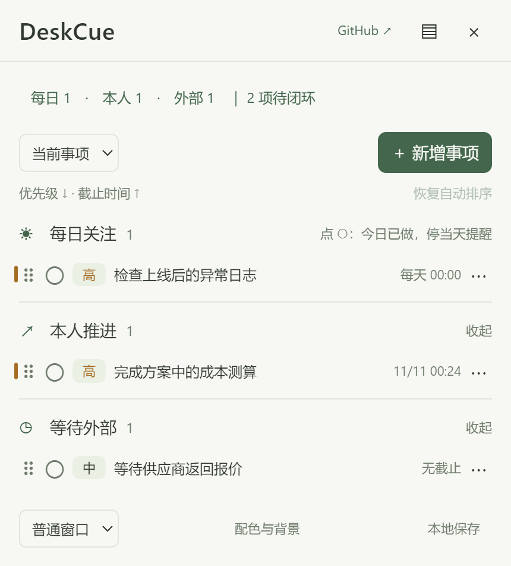

# 案头 · DeskCue

一个在 Windows 桌面上查看事项、到时提醒的本地工具。基于 [Stikly](https://github.com/wilkcraft/stikly) 二次开发，使用 Electron；不需要账号或服务器。

面板按 **每日关注 → 本人推进 → 等待外部** 排列。事项逐条显示，空分类保留一行；可切换普通窗口、桌面背景、悬浮置顶，也可收起为数量摘要。



## 下载与运行

当前版本：**0.1.0，Windows 10/11 x64 便携版**。

**开箱即用：无需安装或配置开发环境，下载 EXE 后双击即可运行。**

[⬇ 下载 Windows EXE](https://github.com/Gemini-yzc/deskcue/releases/download/v0.1.0/DeskCue-0.1.0-windows-x64.exe) · [⬇ 下载完整 ZIP](https://github.com/Gemini-yzc/deskcue/releases/download/v0.1.0/DeskCue-0.1.0-windows-x64.zip) · [SHA256 校验文件](https://github.com/Gemini-yzc/deskcue/releases/download/v0.1.0/SHA256SUMS.txt) · [版本说明](https://github.com/Gemini-yzc/deskcue/releases/tag/v0.1.0)

1. 获取 `DeskCue-0.1.0-windows-x64.exe`，或解压对应 ZIP。
2. 将 EXE 放进有写入权限的文件夹，双击运行。不需要安装 Node.js。
3. 程序在 EXE 旁创建 `data` 文件夹。搬到另一台电脑时，同时复制 EXE 与整个 data。

不要直接在 ZIP 内运行，不要放进只读目录。关闭窗口会收进系统托盘并继续提醒；右键托盘选择“退出案头”才结束程序。再次双击 EXE 会显示现有窗口，不重复启动。

项目地址：[Gemini-yzc/deskcue](https://github.com/Gemini-yzc/deskcue)。EXE、ZIP 与校验文件通过 GitHub Releases 分发；源码仓库不提交 dist 产物或个人 data。下载包不含任何预置个人事项，首次运行时才在 EXE 旁创建 data。

## 三类事项

| 分类 | 时间与内容 | 如何闭环 |
| --- | --- | --- |
| 每日关注 | 可选起止日期、每日时间、检查要点 | 点左侧圆圈表示“今日已关注”；次日重置。最后一天确认后完成整项，也可用“结束整项”提前结束 |
| 本人推进 | 下一步动作、可选最后期限（lastday） | 标记完成 |
| 等待外部 | 等待对象、跟进时间、可选最终期限 | 结果收到且不再需要行动时完成；仍需本人推进则点击“转为本人推进” |

等待事项转到本人推进时，已有提醒时刻被保留，持续闪耀不因转换分类中断。每日事项超过结束日期、最后一次仍未确认时，会保留最后一次提醒，直到闭环。前面日期未确认的提醒不逐日累积。

每条可随时调整高／中／低优先级，同优先级内用上／下按钮调整顺序。时间临近不会偷偷改变手动优先级。点事项标题或“编辑”修改内容。

## 提醒规则

- 每日事项使用指定的每日时间；其他事项可以选择不提醒、相对期限提前若干分钟、直接指定提醒日期和时间。
- 等待事项的相对提醒优先以跟进时间计算，没有跟进时间时使用最终期限。提前量支持 0 至 525600 分钟，0 表示准时。
- 最后期限由日期和时间组成，界面默认时间是 18:00，可以修改。所有输入和日常周期按照电脑本地时间；具体时刻以 ISO 时间保存。
- 到达提醒时间后，事项边缘和摘要持续柔和闪耀；看过事项、关闭系统通知、隐藏窗口都不会停止。只有当天确认、完成、取消或明确修改提醒设置才改变提醒状态。
- 托盘在有待闭环提醒时交替显示提醒图标。每个事项提醒周期只发送一次无声系统通知，多个同时触发时合并展示。已通知标记会保存，重启后不反复通知，但未闭环的闪耀会恢复。
- 应用启动、解锁或休眠恢复时补检查；正常运行按最近提醒时刻调度，最迟每分钟校验一次。关闭到托盘可以继续提醒，完全退出或电脑关机时不能提醒。
- 系统通知能否显示取决于 Windows 通知设置和勿扰模式；事项和托盘的待闭环状态独立保留。系统启用减少动态效果时，界面使用静态高亮替代动画。

## 取消、完成与保留期限

“取消事项”停止提醒，并移入“已取消”。从取消时刻起保留至次年同日，超过一年后自动清除；闰日取次年二月末。恢复后重新参与提醒，再次取消则重新计时。已完成事项保留，不自动清除。

运行期间至多约一分钟内执行过期清理；程序关闭期间不执行，下一次启动补清理。备份中的过期取消事项也会过滤，避免通过普通备份恢复过期记录。

## 数据与备份

```text
DeskCue-0.1.0-windows-x64.exe
data/
  tasks.json          事项、顺序、日期、提醒标记与窗口设置
  backups/            按天保存的 JSON 备份，保留最近七个日历日
  runtime/            Electron 缓存、会话、日志目录
```

数据是明文 JSON，**保存在 EXE 旁边，不写进 EXE 内部**。便携 EXE 启动时仍会把运行时解压到系统临时目录，这是打包器运行机制；事项、设置和应用缓存均使用 data。更新时替换 EXE，保留 data。

保存由主进程验证后写入临时文件、刷新磁盘，再原子替换主文件。保存失败会在界面显示错误，不会将失败动作显示为成功。备份失败另行提示，已成功保存的事项不回滚。每日备份保存该日最近一次成功状态，不是每次修改都留一份历史。

主文件损坏时尝试读取最新有效备份，损坏文件保留为 `tasks.json.corrupt-*` 并提示恢复；没有可用备份时停止启动，不会悄悄清空。损坏文件可能含历史内容，确认恢复后可自行删除。

点击“本地保存”可打开数据文件夹。手动恢复时先从托盘退出程序，备份整个 data，再把选定备份复制为 tasks.json。恢复后仍会按当前时间清除超过一年的取消事项。

DeskCue 使用独立的数据目录，不自动覆盖或导入原版 `%APPDATA%\stikly` 便签。当前没有云同步、加密或原版便签导入功能。

## 开发

要求：Windows 10/11 x64、Node.js 20+、npm。本地验证环境为 Node.js 24.16.0、npm 11.13.0。

```powershell
npm ci
npm start
npm run check
npm test
npm run dist
npm run bundle
```

`npm run dist` 生成单文件便携 EXE；`npm run bundle` 将 EXE、许可和说明打成 ZIP，并输出 SHA256SUMS.txt；`npm run pack` 生成可直接执行的解包目录。所有构建使用 `--publish never`，不会自动发布。产物位于 dist，开发运行数据位于项目 data。

Electron 安装需要下载官方运行时。如果依赖已安装但提示运行时缺失，可以执行 `node node_modules/electron/install.js`。下载停滞时，需为该安装进程设置 `ELECTRON_GET_USE_PROXY=1` 与适用的 `GLOBAL_AGENT_HTTPS_PROXY`；不要把代理地址写进代码。不要跳过官方压缩包校验。

可用 `npm start -- --data-dir=F:\some-writable-folder\deskcue-test` 指定隔离数据目录用于调试。该参数也适用于 EXE。不要在多进程中直接编辑同一 JSON 文件。

```text
main.js                  窗口、托盘、通知、调度与IPC入口
preload.js               受限的界面通信桥接
src/domain.js            事项验证、提醒计算、周期与一年保留规则
src/storage.js           原子保存、备份、损坏恢复
src/app.html/.css/.js     中文事项面板和编辑器
tests/                   业务与磁盘存储测试
scripts/check.js         JavaScript语法检查
windows-window.*         上游 Windows 原生窗口层桥接
docs/SPEC.md             已确认的功能规格
.github/                 Windows CI、Issue与PR模板
```

测试使用 Node.js 自带 node:test，覆盖提醒临界时间、每日重置、等待转换、闰年保留期、输入校验、排序、写入失败和备份恢复。GitHub Actions 在 Windows 上安装依赖、检查、测试和打包，EXE 作为构建附件，不自动创建 Release。

正式发布使用单独的手动工作流 **Publish verified Windows release**：填入本仓库成功的 Windows CI run ID 和版本标签（如 v0.1.0）。工作流复用该次构建的附件，验证 SHA256、ZIP 文件白名单及内嵌 EXE 一致性后上传 Release；只发布 EXE、ZIP 和校验文件，不上传 data、备份或缓存。已公开的 Release 不会被该流程覆盖，日常推送也不会自动发布。

本地验证：13 项业务与存储测试通过；源码版、便携 EXE 的界面保存、每日确认、分类转换、取消恢复、摘要收起、三种窗口模式、进程重启及 EXE 同目录数据均完成检查。系统通知的实际送达仍取决于 Windows 设置，未在其他 Windows 版本或其他电脑上验证。

实际窗口验证使用 `node scripts/smoke.js`，打包后使用 `node scripts/smoke.js dist/DeskCue-0.1.0-windows-x64.exe --portable-default`。脚本在 work 中建立隔离实例，通过仅本次启动开启的本地调试端口验证新增、保存、每日确认、分类转换、取消恢复、收起窗口和三种显示模式，并重启进程确认数据与通知标记恢复。测试结束只终止脚本启动的进程，不接触真实 data。

## macOS 与已知限制

**本次不开发、不打包、不声明支持 macOS。** 界面和业务逻辑可复用，但 `windows-window.*` 依赖 Windows。后续 Mac 版本需要另做桌面层级、菜单栏与通知授权适配，并把数据放到 `~/Library/Application Support/DeskCue/`，而不是写进 `.app` 内。

- 桌面背景层依赖 Windows Explorer 的桌面结构，不同 Windows 版本、多显示器或 Explorer 重启后可能需要切换显示模式恢复；普通窗口与悬浮模式可作为备用。
- 首版仅提供 Windows x64；没有开机自启、自动更新或跨设备同步。
- EXE 尚未做商业代码签名；当前使用上游 Electron 31.7.7，升级运行时需另行验证桌面兼容性，参见 SECURITY.md。
- 单个面板包含全部事项，避免为每条事项创建独立浏览器窗口；具体内存与CPU占用取决于运行环境，不承诺未经测量的数值。

## 版本与来源

### 0.1.0

- 从 Stikly 1.3.2 的多便签界面调整为三分类事项面板，加入优先级、日期和持续至闭环的提醒。
- 新增取消一年清理、原子落盘、七日备份和恢复，数据由原版 AppData 改为便携目录 data，原数据不迁移、不删除。
- 删除被新面板替代的旧 note/library/picker/menu 页面及 preload，保留 Windows 桌面桥接与上游图标。
- 补齐开发规格、测试、CI、贡献与问题模板；保留原 MIT 许可证和作者归属。

本项目不是 Stikly 官方发行版。上游提交 `c662faaf20d0b04e88ddf773d7f9b3425f7e58a0`，Copyright (c) 2026 Wilkcraft。完整许可见 [LICENSE](LICENSE)，来源说明见 [THIRD_PARTY_NOTICES.md](THIRD_PARTY_NOTICES.md)。欢迎按 [CONTRIBUTING.md](CONTRIBUTING.md) 提交改动。

本地 Git 的 `origin` 指向 `Gemini-yzc/deskcue`，`upstream` 保留原 Stikly 仓库。`data/`（含嵌套便携数据目录）、`work/`、`.npm-cache/`、`node_modules/` 和 `dist/` 均被 Git 忽略；个人事项、备份与运行缓存不应上传。`tests/` 和测试脚本属于可复用源码，保留在仓库，测试运行生成的临时文件和下载缓存可以清理。
